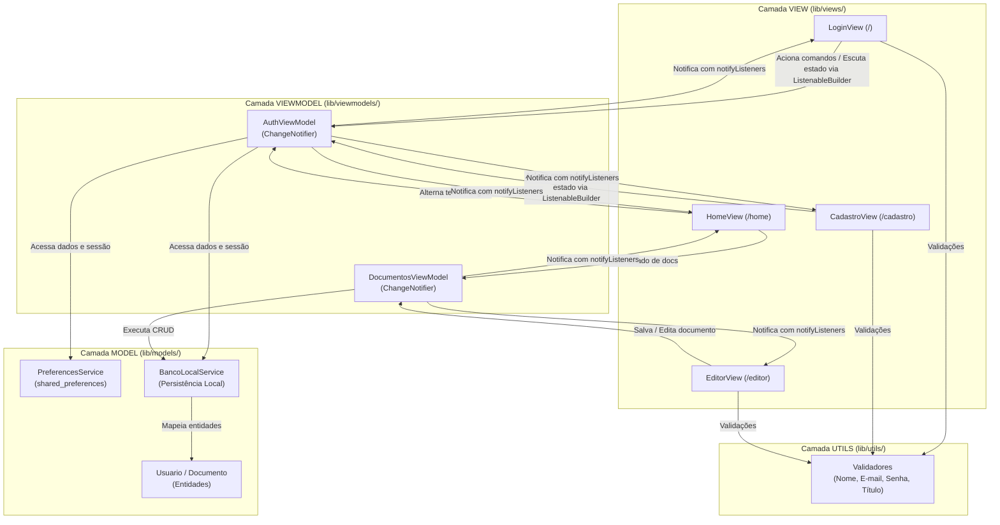

# Relatório Técnico de Migração Arquitetural (MVVM)
**Projeto:** Editor de Documentos Flutter (`edit_doc_flutter`)  
**Fase:** Fase 1 — Migração de Monólito (DartPad) para MVVM

---

## 1. Mapeamento de Classes e Widgets

Na migração do arquivo monolítico do DartPad para a arquitetura estruturada **MVVM (Model-View-ViewModel)**, o código foi decomposto em camadas bem delimitadas, garantindo o princípio da responsabilidade única (SRP) e alta coesão.

A tabela a seguir apresenta o mapeamento de cada elemento do código original para sua respectiva localização na nova estrutura:

| Elemento Original (DartPad) | Tipo / Papel Original | Novo Caminho no Projeto | Camada Arquitetural (MVVM) | Responsabilidade Principal |
| :--- | :--- | :--- | :--- | :--- |
| `class Usuario` | Modelo de dados em memória | `lib/models/usuario.dart` | **Model** | Entidade de usuário, serialização (`toMap`/`fromMap`) e imutabilidade (`copyWith`). |
| `class Documento` | Modelo de dados em memória | `lib/models/documento.dart` | **Model** | Entidade de documento com id, título, conteúdo, data de modificação e vínculo com autor. |
| Funções de persistência e SharedPreferences | Lógica inline e mocks dispersos | `lib/models/services/preferences_service.dart` | **Model (Service)** | Leitura e gravação de preferências (tema claro/escuro e sessão do usuário). |
| Simulação de banco / listas estáticas | Listas globais estáticas no arquivo único | `lib/models/services/banco_local_service.dart` | **Model (Service)** | Gerenciamento de persistência local e CRUD completo de Usuários e Documentos. |
| Funções `validarEmail`, `validarSenha`, etc. | Funções soltas no topo do arquivo | `lib/utils/validadores.dart` | **Utils** | Métodos estáticos puros para validação de campos de formulário (Nome, E-mail, Senha e Título). |
| Lógica de login, cadastro e controle de sessão | Métodos internos com `setState()` nas telas | `lib/viewmodels/auth_viewmodel.dart` | **ViewModel** | Regras de autenticação, persistência de preferências de tema e usuário ativo (`ChangeNotifier`). |
| Lista de documentos e métodos de CRUD | Variáveis globais manipuladas na tela | `lib/viewmodels/documentos_viewmodel.dart` | **ViewModel** | Estado da listagem de documentos, flags de loading e operações de CRUD (`ChangeNotifier`). |
| `TelaLogin` / `LoginScreen` | `StatefulWidget` com lógica e UI misturadas | `lib/views/login_view.dart` | **View** | Interface gráfica da rota `/`. Apenas renderiza formulário e delega ações ao `AuthViewModel`. |
| `TelaCadastro` / `CadastroScreen` | `StatefulWidget` com lógica e UI misturadas | `lib/views/cadastro_view.dart` | **View** | Interface gráfica da rota `/cadastro`. Delega o registro ao `AuthViewModel`. |
| `TelaHome` / `HomeScreen` | `StatefulWidget` com listagem e diálogo de exclusão | `lib/views/home_view.dart` | **View** | Interface gráfica da rota `/home`. Exibe listagem reativa via `ListenableBuilder` e ações de logout/tema. |
| `TelaEditor` / `EditorScreen` | `StatefulWidget` com edição de texto | `lib/views/editor_view.dart` | **View** | Interface gráfica da rota `/editor`. Criação e edição de documentos integradas ao `DocumentosViewModel`. |
| `void main()` e `MaterialApp` | Configuração direta e inicialização do app | `lib/main.dart` | **Entry Point / Config** | Inicialização assíncrona, injeção de dependências, `ThemeData` reativo e mapeamento de rotas nomeadas. |

---

## 2. Alterações de Estrutura e Imports

A transição de um ambiente de script único (DartPad) para um projeto profissional em múltiplos arquivos exigiu adaptações essenciais:

1. **Modularização e Organização de Imports:**
   - No DartPad, todos os componentes compartilhavam o mesmo namespace sem necessidade de diretivas de importação.
   - Na nova arquitetura, cada arquivo explicita estritamente suas dependências por meio de imports relativos ou de pacotes (`package:shared_preferences/shared_preferences.dart`, `package:flutter/material.dart`).
   - Evitou-se acoplamento circular mantendo o fluxo unidirecional: **Views dependem de ViewModels; ViewModels dependem de Models/Services; Models não conhecem nenhuma camada superior.**

2. **Encapsulamento e Visibilidade de Atributos:**
   - Variáveis que antes eram acessadas diretamente de qualquer ponto do código foram privatizadas com o prefixo `_` (por exemplo: `_usuarioAtual`, `_documentos`, `_isLoading`, `_isDarkTheme`).
   - O acesso a esses estados passou a ser feito exclusivamente por meio de *getters* públicos imutáveis (`List<Documento> get documentos => List.unmodifiable(_documentos);`), impedindo mutações indevidas do estado a partir da View.

3. **Injeção de Dependências e Criação de Construtores:**
   - As classes de serviço e ViewModels deixaram de usar variáveis estáticas globais.
   - Foram implementados construtores com injeção explícita:
     - `AuthViewModel(bancoService: ..., prefsService: ...)`
     - `DocumentosViewModel(bancoService: ...)`
     - `LoginView({required this.authViewModel})`
     - `HomeView({required this.authViewModel, required this.documentosViewModel})`
   - Isso permite maior desacoplamento, facilita testes unitários e viabiliza a substituição de serviços por mocks.

4. **Padronização de Rotas Nomeadas:**
   - No DartPad, a navegação ocorria através de `Navigator.push(context, MaterialPageRoute(builder: (context) => TelaX()))`, acoplando diretamente uma tela à outra.
   - Na nova estrutura, o arquivo `lib/main.dart` centraliza o mapeamento declarativo de rotas nomeadas:
     - `'/'` $\rightarrow$ `LoginView`
     - `'/cadastro'` $\rightarrow$ `CadastroView`
     - `'/home'` $\rightarrow$ `HomeView`
     - `'/editor'` $\rightarrow$ `EditorView`
   - A navegação é executada com `Navigator.pushNamed()` e `Navigator.pushReplacementNamed()`, desacoplando completamente a origem do destino.

---

## 3. Mudanças no Gerenciamento de Estado

O gerenciamento de estado da aplicação foi completamente reestruturado para atender às melhores práticas do Flutter e ao padrão MVVM:

### A. Eliminação de `setState()` para Regras de Negócio
- **Antes (DartPad):** Ao clicar em "Entrar", "Cadastrar" ou "Salvar", as telas executavam funções assíncronas internamente e chamavam `setState(() { carregando = true; ... })` diretamente na View. As telas acumulavam lógica de negócio, persistência e apresentação.
- **Depois (MVVM):** As telas (Views) tornaram-se passivas. Toda lógica de validação de regras de negócio, chamadas aos serviços de persistência e controle do ciclo de vida das requisições foram transferidos para os ViewModels.
- **Uso Restrito de `setState()` na View:** O uso de `setState()` nas Views foi restrito exclusivamente ao controle de estado efêmero de UI local (ex.: alternar a visibilidade de senha `_senhaOculta = !_senhaOculta`).

### B. ViewModels como `ChangeNotifier` e Notificação Reativa
- As classes `AuthViewModel` e `DocumentosViewModel` herdam de `ChangeNotifier`.
- Quando uma mutação de estado ocorre, o ViewModel executa `notifyListeners()`. Exemplo em `AuthViewModel`:
  ```dart
  Future<bool> login(String email, String senha) async {
    _isLoading = true;
    _mensagemErro = null;
    notifyListeners(); // Notifica a View para exibir o spinner de loading

    try {
      final usuario = await _bancoService.autenticar(email, senha);
      if (usuario != null) {
        _usuarioAtual = usuario;
        _isLoading = false;
        notifyListeners(); // Notifica a View com o usuário autenticado
        return true;
      }
      // ...
    } catch (e) {
      // ...
    }
  }
  ```

### C. Consumo Reativo com `ListenableBuilder`
- Em vez de redesenhar a tela inteira com `setState()`, as Views e o aplicativo raiz utilizam o widget nativo `ListenableBuilder`:
  ```dart
  ListenableBuilder(
    listenable: widget.authViewModel,
    builder: (context, _) {
      final carregando = widget.authViewModel.isLoading;
      return ElevatedButton(
        onPressed: carregando ? null : _fazerLogin,
        child: carregando ? CircularProgressIndicator() : Text('Entrar'),
      );
    },
  )
  ```
- **Vantagens Obtidas:**
  1. **Rebuilds Cirúrgicos:** Apenas os widgets que dependem diretamente do estado notificado são reconstruídos, otimizando o consumo de memória e performance de renderização no Flutter.
  2. **Tema Reativo:** No `lib/main.dart`, o `MaterialApp` está envelopado em um `ListenableBuilder` observando o `AuthViewModel`, permitindo que a troca entre tema claro e escuro ocorra instantaneamente em toda a aplicação sem recarregar rotas.
  3. **Zero Dependências Externas Desnecessárias:** A reatividade funciona de forma moderna e robusta utilizando exclusivamente componentes nativos do Flutter SDK (`ChangeNotifier` + `ListenableBuilder`), sem acoplamento a bibliotecas legadas.

---

## 4. Diagrama da Arquitetura Implementada


